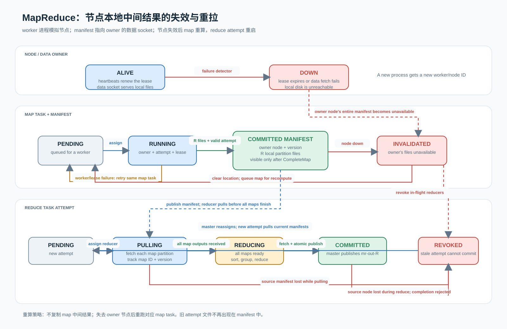
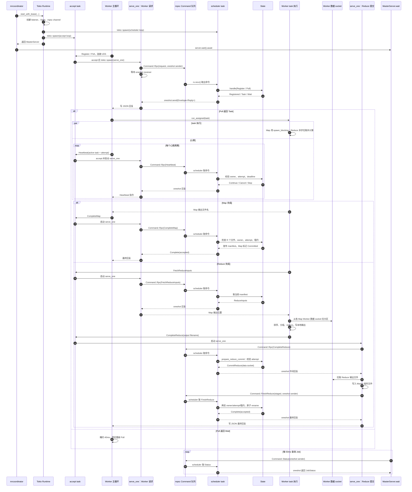

# MapReduce 协议、租约与故障恢复

## 设计依据与运行边界

MapReduce 论文以 Master 跟踪任务、Worker 定期联系 Master，并在 Worker 失效后重新执行任务作为主要恢复方式。Map 输出写在 Worker 本地磁盘；如果持有输出的机器失效，Master 使输出不可用并重跑对应 Map。Reduce 从 Map Worker 拉取分区，任务结果只由 Master 接受并发布。[Dean 与 Ghemawat，OSDI 2004](https://www.usenix.org/legacy/publications/library/proceedings/osdi04/tech/full_papers/dean/dean_html/index.html)

本原型用 Tokio async task 管理单机上的多个进程，控制面和数据面分别使用 Unix Domain Socket。Master 状态由一个调度循环串行修改；连接 handler 只解析请求、向调度循环发命令并等待回复。输入文件对本机 Worker 可见，map spill 文件落入各 Worker 的 `node-{worker_id}` 目录。Coordinator 重启恢复和多机网络传输不在本版范围。

## Rust package 选择

- `tokio`：多线程 runtime、UDS、异步 IO、timer、channel 和 `spawn_blocking`。
- `tokio-util::sync::CancellationToken`：取消信号。Worker 在输入行、记录和文件块边界协作检查；阻塞工作放在 blocking pool。
- `serde` + `serde_json`：控制 RPC 的 JSON Lines 编解码。
- `thiserror`：为协议和运行错误提供可区分的错误类型；测试目录使用 `tempfile`。

取消只是通知，不作为正确性边界。即使旧任务不响应取消，Master 仍以 attempt ID 拒绝旧结果。临时输出采用 attempt 专属文件名，Master 只发布校验通过的当前 attempt。

## RPC 协议

每条控制连接发送一个 JSON 行并读取一个 JSON 行。请求和回复都包含 `{ version: 1, request_id, body }`。服务拒绝未知版本或 request ID 不匹配的回复。Map/Reduce 大文件不放进 JSON；worker 数据 socket 先交换带文件名和长度的 JSON 头，再传输原始字节。数据接口只接受单个普通文件名，拒绝路径遍历。

| 请求                                                       | 校验/效果                                                                         | 主要回复                               |
| ---------------------------------------------------------- | --------------------------------------------------------------------------------- | -------------------------------------- |
| `Register(worker_id, data_socket)`                         | 注册新的 Worker incarnation；Down ID 不可复活；回复返回实际 lease ms              | `Registered(lease_ms)` / `Error`       |
| `Poll(worker_id)`                                          | 续 Worker 存活时间并分配 Map；所有 Map 至少已派发后可分配 Reduce                  | `Task` / `Wait` / `Stop`               |
| `Heartbeat(worker_id, active?)`                            | 更新 Worker 存活时间；仅匹配当前 owner、task、attempt 且未过期的任务续租          | `Continue` / `Cancel` / `Stop`         |
| `FetchReduceInputs(worker, task, attempt, known_versions)` | 仅当前 Reduce owner 可取新 manifest；manifest 以 map ID + version 标识            | `ReduceInputs(outputs, all_maps_done)` |
| `CompleteMap(worker, task, attempt, outputs)`              | 验证 owner、attempt、R 个本地文件后发布新 manifest version                        | `Complete(accepted)`                   |
| `CompleteReduce(worker, task, attempt, output)`            | 校验当前 attempt，异步从 Worker 数据 socket 拉文件，重新校验后原子发布            | `Complete(accepted)`                   |
| `MapOutputFailure(..., map_id, source_worker, version)`    | 只处理与当前 manifest owner/version 匹配的失败报告；失效该 Worker 的所有 map 输出 | `Ack(accepted)`                        |
| `Fail(worker, task_ref, fatal, error)`                     | 当前 attempt 可报告失败；fatal 错误终止 Job，否则重新排队                         | `Ack(accepted)`                        |
| `Cancelled(worker, task_ref)`                              | 记录取消确认；旧 attempt 不恢复所有权                                             | `Ack(accepted)`                        |

每个 Map attempt 写 R 个独立分区文件，完成 RPC 成功后 Master 才公布 manifest。Reducer 拉取时追踪每个 `map_id/version`；任一来源节点失效会使所有运行中的 Reduce attempt 失效，避免使用混合版本输入。Reduce 文件先被 coordinator 拉入临时文件；调度循环在截止时间前再次校验 owner/attempt 后，使用原子 rename 发布 `mr-out-R`。

## 租约与安全保证

默认 Worker 心跳间隔 2 秒，任务/Worker 租约 10 秒；配置由 `MR_HEARTBEAT_MS` 和 `MR_TASK_LEASE_MS` 提供。注册回复携带当前 lease，Worker 将心跳间隔限制在 lease 的三分之一以内。这是容忍短暂抖动的初始值，不是故障证明。Master 使用单调时钟，worker 时钟不参与判定。定义租约有效条件为 `now < deadline`：等于截止时间也视为过期。调度循环串行处理心跳、超时、提交；每个 RPC 在改状态前检查 owner/attempt/deadline。

心跳超时是故障检测器，可能把暂停或过载的活 Worker 判为 Down。安全性不依赖“旧 Worker 已停止”：

1. 每次派发递增 attempt；重派后只接受新 attempt。
2. 完成、失败、输入拉取都校验 worker/task/attempt 与有效租约。
3. Map manifest 包含单调递增 version；旧版输出失败报告不能使新版本失效。
4. Reduce 输出仅在当前 attempt 重验成功后原子发布。

所以执行可能是 at-least-once，结果提交是 fenced 的单次接受；这不保证同一时间只有一个 Worker 正在计算。

## 完整状态机

`retry` 表示将当前 attempt 作废；若该 task 已执行 10 次（含首次），task 转为 `Failed` 并使 Job 进入 `Failed`。未耗尽时回到 `Pending`。迟到事件一律不改变状态。

### Worker 节点

| 当前状态  | 事件和条件                                         | 下个状态 | 动作                                            |
| --------- | -------------------------------------------------- | -------- | ----------------------------------------------- |
| `Unknown` | 新 ID 注册成功                                     | `Alive`  | 记录数据 socket 与单调时钟时间                  |
| `Alive`   | Poll 或有效 Worker 心跳                            | `Alive`  | 更新 `last_seen`                                |
| `Alive`   | `now - last_seen >= lease`                         | `Down`   | 撤销其运行任务并使其持有的 Map manifest 失效    |
| `Alive`   | reducer 报告当前 manifest 的数据 socket/文件不可读 | `Down`   | 仅在 owner/version 匹配时处理，执行相同失效操作 |
| `Down`    | 任意旧 ID 注册或 RPC                               | `Down`   | 拒绝；重启进程必须用新 ID                       |

### Map task

| 当前状态    | 事件和条件                                                 | 下个状态                              | 动作                                      |
| ----------- | ---------------------------------------------------------- | ------------------------------------- | ----------------------------------------- |
| `Pending`   | Master 派发                                                | `Running(owner, attempt+1, deadline)` | 生成唯一 attempt 输出名                   |
| `Running`   | 所有 R 个输出存在；CompleteMap owner/attempt/deadline 匹配 | `Committed(manifest, version+1)`      | 原子发布 manifest                         |
| `Running`   | Worker 报告 retryable 错误                                 | `Pending` 或 `Failed`                 | 作废 attempt；Reduce 若依赖旧状态则撤销   |
| `Running`   | attempt deadline 到期                                      | `Pending` 或 `Failed`                 | 旧 attempt 后续心跳和提交均拒绝           |
| `Running`   | owner 进入 `Down`                                          | `Pending` 或 `Failed`                 | 重新派发                                  |
| `Committed` | owner 进入 `Down`                                          | `Pending` 或 `Failed`                 | 清空 manifest、递增 map version、重跑 Map |
| `Committed` | 当前 owner/version 的数据读取失败                          | `Pending` 或 `Failed`                 | 按节点故障流程使 manifest 失效            |
| 任意非终态  | fatal 错误或重试耗尽                                       | `Failed`                              | Job 转 `Failed`                           |
| `Failed`    | 任意事件                                                   | `Failed`                              | 不再派发                                  |

### Reduce task

| 当前状态                  | 事件和条件                                         | 下个状态                                | 动作                                       |
| ------------------------- | -------------------------------------------------- | --------------------------------------- | ------------------------------------------ |
| `Pending`                 | 所有 Map 至少已派发，Master 分配 task              | `Shuffling(owner, attempt+1, deadline)` | 从空的 known map 集合开始拉取              |
| `Shuffling`               | 新 manifest 可用                                   | `Shuffling`                             | 拉取并记录 map ID/version                  |
| `Shuffling`               | 所有 Map 已 `Committed` 且当前版本均已拉取         | `Reducing`                              | 排序、分组并调用 reduce                    |
| `Shuffling` 或 `Reducing` | CompleteReduce owner/attempt/deadline 匹配         | `Committing`                            | Master 拉取结果到临时文件，保持心跳续租    |
| `Committing`              | 临时文件完整且提交前 owner/attempt/deadline 仍匹配 | `Committed`                             | 原子 rename 到最终输出                     |
| 任一运行阶段              | retryable 错误或 deadline 到期                     | `Pending` 或 `Failed`                   | 作废 attempt                               |
| 任一运行阶段              | owner 进入 `Down`                                  | `Pending` 或 `Failed`                   | 重新派发                                   |
| 任一运行阶段              | 任一已取 Map manifest 失效                         | `Pending` 或 `Failed`                   | 撤销 attempt，从当前 manifest 集合重新拉取 |
| 任意非终态                | fatal 错误或重试耗尽                               | `Failed`                                | Job 转 `Failed`                            |
| `Committed` 或 `Failed`   | 任意迟到事件                                       | 原状态                                  | 拒绝写入                                   |

### Job 与 Worker 执行器

- Job：`Running → Succeeded` 当所有 Map 和 Reduce 均 `Committed`；`Running → Failed` 当遇到 fatal task 错误或 task 重试耗尽；两个终态不可逆。
- Worker：`Idle → Running` 收到 task；`Running → Idle` 完成/失败并报告；`Running → Cancelling` 收到 `Cancel` 或 `Stop`；`Cancelling → Idle` 在安全点清理当前 attempt 临时文件并报告取消；`Stop` 后 Worker 退出。若阻塞工作不响应取消，Master 仍可租约超时并重派，attempt fencing 保证旧结果不能提交。



可编辑图源：[`tools/generate_mapreduce_state.py`](../tools/generate_mapreduce_state.py)。


## master 的协作

- **`accept` task**：等 Worker 连进 Master 的 UDS。
- **`serve_one` task**：每接到一个连接，就处理这个连接上的一条请求。
- **`scheduler` task**：唯一修改 Master `State` 的任务，负责派发、心跳、提交、重试和 Job 状态。
- **`MasterServer::wait`**：Coordinator 主程序等待 Job 结束；它只查询 Job 状态，不负责处理 Worker 的任务。

它们通过两种通道协作：

- `mpsc` 是**多条命令发给 scheduler 的队列**。
- `oneshot` 是**一条命令对应一个回复**。

### `oneshot` 的 `send` 和 `recv` 怎样配对

以 [call_state](</home/lzy/system_design/shared_kv/mapreduce/src/master.rs:717>) 为例：

```rust
let (send, recv) = oneshot::channel();

tx.send(Command::Rpc(envelope, send)).await?;
recv.await
```

这几步的意思是：

1. `oneshot::channel()` 创建一对一的发送端 `send` 和接收端 `recv`。
2. `send` 被装进 `Command::Rpc`，和请求一起放入 `mpsc` 队列。
3. `tx.send(...).await` 等待命令进入队列。**这只表示“已排队”，不表示已经处理完。**
4. `serve_one` 在 `recv.await` 等待结果；这时它不会忙等，而是让出运行时。
5. scheduler 取出命令并处理后，调用命令里携带的 `send.send(reply)`。
6. 这个 `send` 会唤醒对应的 `recv.await`，把回复交回原来的 `serve_one`。

可以把 `send` 看成这条请求专属的“回信地址”。它随命令一起交给 scheduler；scheduler 回信后，这个通道就完成了。

`oneshot` 在这里有三种用途：

| 用途                               | 谁创建通道   | 谁发送    | 谁接收      |
| ---------------------------------- | ------------ | --------- | ----------- |
| 普通 Worker RPC                    | `call_state` | scheduler | `serve_one` |
| Reduce 最终提交                    | `serve_one`  | scheduler | `serve_one` |
| `MasterServer::wait` 查询 Job 状态 | `wait`       | scheduler | `wait`      |

如果等待的一方提前退出，`send` 或 `recv` 会返回错误。普通 RPC 和状态查询会把这个错误转成 `io::Error`；scheduler 的回复代码使用 `let _ = reply.send(...)`，表示如果原请求连接已经没了，就忽略发不出去的回复。

### `spawn` 任务？

[`start_with_lease`](</home/lzy/system_design/shared_kv/mapreduce/src/master.rs:754>) 里有：

```rust
let scheduler = tokio::spawn(async move { /* scheduler loop */ });
let accept = tokio::spawn(async move { /* accept loop */ });
```

`tokio::spawn` 会把 Future **提交给 Tokio runtime 调度**，并立刻返回一个 `JoinHandle`。它不等待 Future 完成；runtime 之后会 poll 这个 Future。多线程 runtime 下，它可能与当前函数并行运行，甚至可能在 `spawn` 返回之前就开始执行；代码不能依赖这个精确时机。

还有个重要区别：

- `scheduler` 和 `accept` 是通过 `tokio::spawn` 启动的独立 Tokio task。
- `serve_one` 是每次 accept 后再通过 `tokio::spawn` 启动的连接 task。
- Worker 的 `work = async { ... }` 和 `heartbeat_loop(...)` 本身**没有被 `tokio::spawn`**。`run_assigned` 用 `tokio::select!` 同时 poll 它们。
- Map 的同步计算内部使用 `spawn_blocking`，把可能阻塞的工作交给 blocking pool。

因此，`async { ... }` 或 `pin!` 不等于启动后台任务；Future 要被 `await`、`select!` 等方式 poll 才会运行。

### `wait`？

Coordinator 的入口会这样使用 Master：

```rust
let server = MasterServer::start_with_lease(...).await?;
server.wait().await?;
```

`start_with_lease` 的工作是创建 socket、初始化 State、启动 scheduler 和 accept task，然后返回 `MasterServer`。它不会一直占着当前函数等 Job 完成。

[`wait`](</home/lzy/system_design/shared_kv/mapreduce/src/master.rs:840>) 每 50 毫秒通过 `Command::Status` 向 scheduler 查询一次：

```text
Running   → 睡 50ms，再查
Succeeded → 返回 Ok
Failed    → 返回错误
```

为什么查询也要走 scheduler？因为 scheduler 是 `State` 的唯一拥有者。让它回答状态，可以避免 `wait` 和 RPC handler 并发读写同一个 State。

如果 Coordinator 不调用并等待 `server.wait()`，主程序可能直接结束，MasterServer 被 drop，socket 和运行中的 task 都会被关闭。

### Task 协作流程
**普通 RPC 的协作流程**
以 Poll 为例：
```
Worker
  │ 发一条 JSON 请求
  ▼
serve_one
  │ call_state：发 Command::Rpc，然后等待回复
  ▼
scheduler
  │ State::handle(Request::Poll)
  │ State::poll(...)，选择并分配任务
  ▼
serve_one
  │ 收到 Reply::Task
  ▼
Worker
```
在 [serve_one (line 878)](/home/lzy/system_design/shared_kv/mapreduce/src/master.rs:878) 里，普通请求都会走到：
```rust
let response = call_state(&tx, request_id, envelope.body).await?;
```
而 [call_state (line 717)](/home/lzy/system_design/shared_kv/mapreduce/src/master.rs:717) 做的事情是：
  1. 创建一个 oneshot 回复通道。
  2. 把 Command::Rpc(request, reply_sender) 发进 scheduler 的 mpsc 队列。
  3. 等 scheduler 通过 oneshot 回传结果。
Scheduler 在 [命令循环 (line 795)](/home/lzy/system_design/shared_kv/mapreduce/src/master.rs:795) 收到 Command::Rpc 后，检查协议版本，然后执行：
```rust
state.handle(envelope.body)
```
State::handle 再按请求类型分发：Poll 调 poll，Heartbeat 调 heartbeat，CompleteMap 调 complete_map，以此类推。结果经 oneshot 回给 serve_one，最后由 `serve_one` 写回 Worker。所以，`serve_one` 负责收发和转发；scheduler 才负责业务状态处理。

**Reduce 完成的特殊流程**
```
Worker
  │ CompleteReduce(task, attempt, output filename)
  ▼
serve_one
  │ call_state(Command::Rpc)
  ▼
scheduler
  │ State::handle → prepare_reduce_commit
  │ 校验 owner、attempt、租约
  │ 返回内部的 CommitReduce(data_socket)
  ▼
serve_one
  │ 从 worker data_socket 拉取文件字节
  │ 写入 Master 临时文件
  │ 发 Command::FinishReduce
  ▼
scheduler
  │ finish_reduce_commit 再验 attempt/租约
  │ 原子 rename，标记 Reduce 为 Committed
  ▼
serve_one
  │ 把最终 Complete 回复写给 Worker
```
### scheduler 的 handle 逻辑
*Worker 注册*
- register 把 worker ID、数据 socket、last_seen 和 alive 记录到 workers。同一个还活着的 ID 可以重复注册，但不能改绑到另一个 socket。已经标记为 Down 的 worker ID 不能复活；重启 Worker 应使用新 ID。
- 注册回复里会带 lease 毫秒数，让 Worker 据此配置心跳间隔。
*Poll 与任务分配：*
- poll 先确认 Job 仍在运行、Worker 仍活着，然后按顺序找 Pending task：
  1. 有待处理 Map 时，先分配 Map。
  2. 没有待分配 Map，且所有 Map 都至少已被派发时，开始分配 Reduce。
  3. 当前没有可分配任务时返回 Wait。
  4. Job 成功时返回 Stop；Job 失败时返回错误。
- 这里的“所有 Map 都已派发”不是“所有 Map 都已完成”。因此 Reduce 可以提前开始拉取已完成 Map 的输出，同时等待其余 Map 完成。
- 分配时 [`assign` (line 681)](/home/lzy/system_design/shared_kv/mapreduce/src/master.rs:681) 增加 attempt 计数，并记录 owner、截止时间和阶段。
*Heartbeat 和租约*
- 在 [heartbeat (line 272)](/home/lzy/system_design/shared_kv/mapreduce/src/master.rs:272) 里：
  - Worker 不存在或已经 Down：回复 Stop。
  - 空闲心跳没有 active task：只更新 Worker 的 last_seen。
  - 正在执行的 task：检查 Worker、task ID、attempt 是否与 Master 当前记录一致，以及 deadline > now 是否成立。
  - 全部匹配才续租并回复 Continue。
  - attempt 过期、被撤销或不匹配则回复 Cancel。
- 判断任务是否仍归某 Worker 所有的公共检查在 [`owns` (line 644)](/home/lzy/system_design/shared_kv/mapreduce/src/master.rs:644)。它要求：
  - 状态是 Running
  - owner == 报告的 worker
  - attempt == 报告的 attempt
  - deadline > 当前单调时钟
- 也就是说，旧 attempt 即使还在运行，也不能靠迟到的心跳重新获得任务。
*Map 输出提交*
- [complete_map (line 384)](/home/lzy/system_design/shared_kv/mapreduce/src/master.rs:384) 检查：
  1. Job 仍在运行，Worker 仍然 alive。
  2. 输出文件数正好是 n_reduce。
  3. 文件名是普通文件名，不能带目录遍历路径。
  4. task 当前仍由这个 worker 和 attempt 持有，租约仍有效。
  5. R 个输出文件都确实存在于该 Worker 的本地模拟目录。
- 检查都通过后，Master 增加 map manifest version，保存 owner、version 和文件名，并把 Map task 转为 Committed。Reducer 之后才看得到这份 manifest。
*Reduce 输入拉取和 Reduce 阶段*
- [fetch_inputs (line 319)](/home/lzy/system_design/shared_kv/mapreduce/src/master.rs:319) 只接受当前 Reduce owner/attempt 的请求。它根据 reducer 提供的 known 版本列表，返回尚未取得的 Map 输出位置。
- 当所有 Map 都 Committed 且该 reducer 已知全部当前输出时，Reduce 阶段从 Shuffling 进入 Reducing。这里的 known 表示 reducer 报告自己已经取得哪些 map/version。
- **Reduce 输出提交：为什么分两阶段**
> Reduce 输出可能较大，不能在持有调度状态时把整个文件从 Worker 拉过来。因此提交拆成“校验并准备”和“拉文件后最终提交”：
  1. Worker 发 CompleteReduce。
  2. 调度循环调用 [prepare_reduce_commit (line 429)](/home/lzy/system_design/shared_kv/mapreduce/src/master.rs:429) 校验当前 attempt，并把 Reduce 阶段设为 Committing，重置租约。
  3. 它暂时回复内部的 CommitReduce { data_socket }。
  4. [serve_one (line 878)](/home/lzy/system_design/shared_kv/mapreduce/src/master.rs:878) 拦截这个中间回复，在 handler 里从 Worker 数据 socket 拉文件并写入临时文件。
  5. handler 发 Command::FinishReduce 回调度循环。
  6. 调度循环调用 finish_reduce_commit，再次检查当前 attempt 和租约；仍有效才把临时文件原子重命名为 mr-out-N 并标记 Committed。
  注意：CommitReduce 是 Master 内部两阶段流程中的回复，serve_one 处理完文件后才把最终的 Complete 回复写给 Worker。
- **最终重验很关键：文件传输期间任务可能过期或被撤销，所以不能只依赖传输开始时的校验**
*Map 输出丢失或 Worker 宕机*
- 两种情况会走到 [mark_worker_down (line 573)](/home/lzy/system_design/shared_kv/mapreduce/src/master.rs:573)：
  - 定时扫描发现 now - last_seen >= lease。
  - Reducer 报告当前 manifest 的文件无法读取，而且报告中的 source_worker 和 version 仍与当前 manifest 匹配。
  mark_worker_down 会：
    1. 把 Worker 标为 Down。
    2. 将它正在执行的 Map/Reduce attempt 置为重试。
    3. 删除它持有的所有已提交 Map manifest，递增相应版本并重新排队这些 Map。
    4. 如果 Map 输出发生变化，撤销所有运行中的 Reduce attempt，让新 Reducer 从新的 manifest 集合重新拉取。
    第 4 步避免 Reducer 把旧缓存和重算后的新 Map 输出混合起来。
    失败、重试上限和 Job 状态
  task_failed 先用 owns 判断失败报告是否来自当前 attempt：
     - fatal = true：Job 直接进入 Failed。
     - fatal = false：调用 retry，在 Pending 和 Failed 之间选择。
- [`retry` (line 693)](/home/lzy/system_design/shared_kv/mapreduce/src/master.rs:693) 检查执行次数：少于 10 次回到 Pending；已达 10 次则进入 Failed。Master 发现任一 task Failed 后，也会把 Job 转为 Failed。

- 所有 Map 和 Reduce 都成为 Committed 后，[check_success (line 651)](/home/lzy/system_design/shared_kv/mapreduce/src/master.rs:651) 把 Job 转为 Succeeded。
  1. 启动函数返回后的生命周期
  start_with_lease 创建并返回 MasterServer，但不会自己等待作业完成。Coordinator 程序随后调用：
  server.wait().await?;
  wait 通过 Command::Status 向同一个调度循环查询 Job 状态，每 50 毫秒查询一次：
  - Running：继续等待。
  - Succeeded：正常返回。
  - Failed：把保存的失败原因返回给 CLI。
  最后 MasterServer 被 drop 时，会取消/中止接入任务和调度任务，并删除 coordinator socket。
### 一项 task 从分配到完成的时序

下面把启动、RPC、状态处理和 task 执行放在同一张图里。Map 和 Reduce 共用 Poll、Heartbeat、提交通路；Reduce 额外有 shuffle 拉取和输出文件传输。


